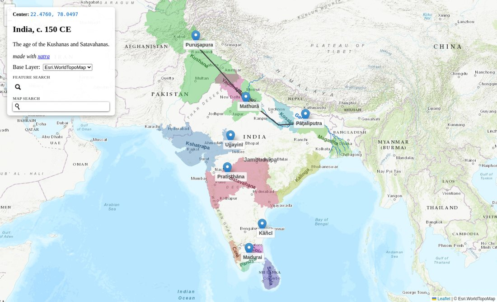
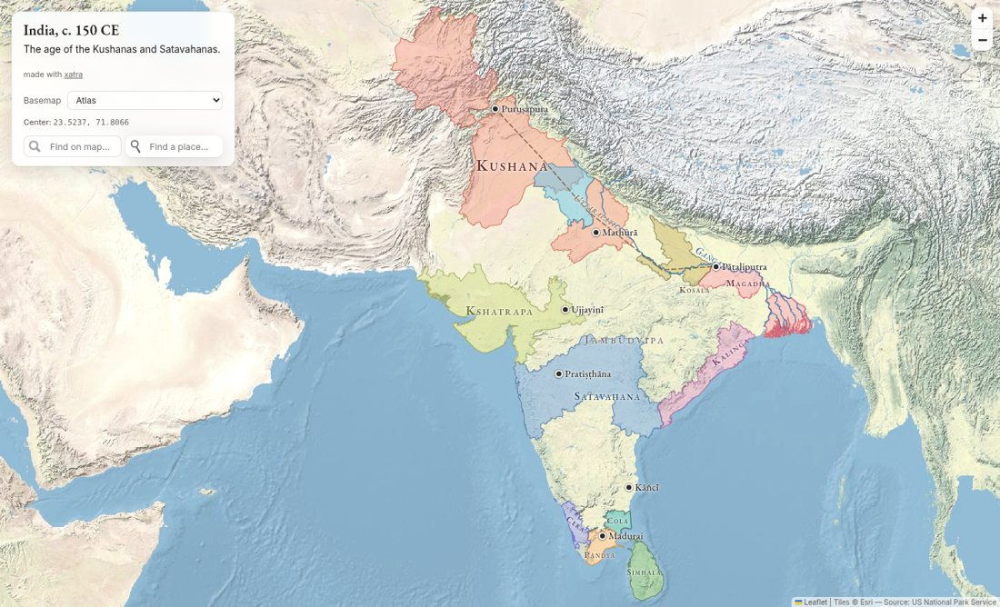
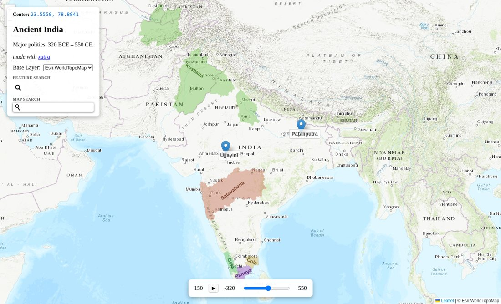
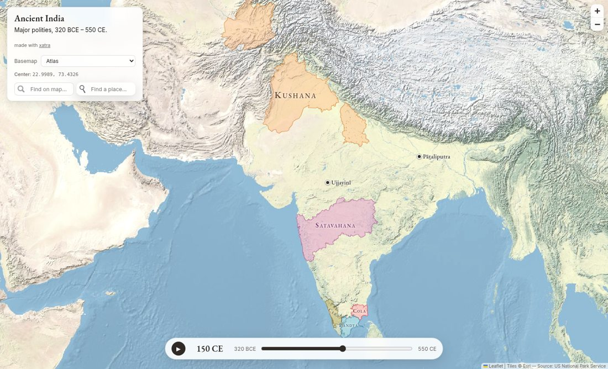
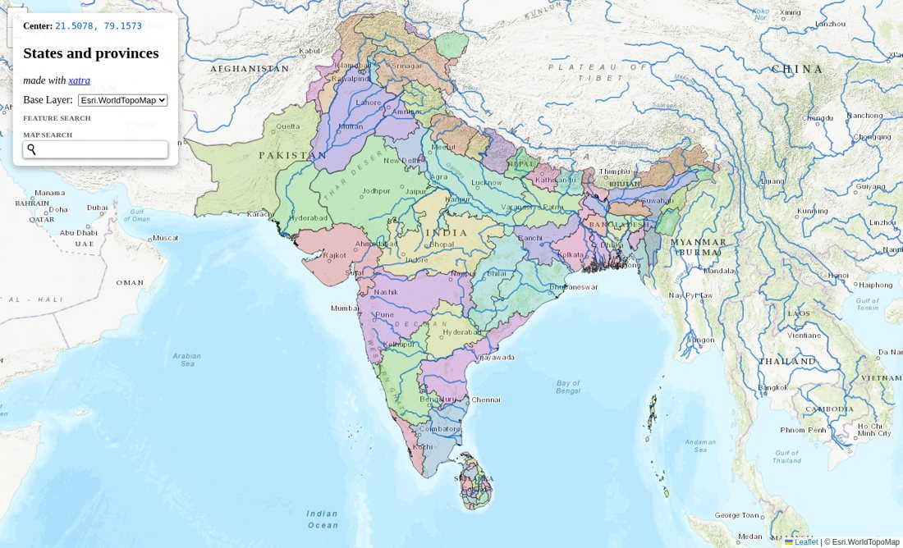
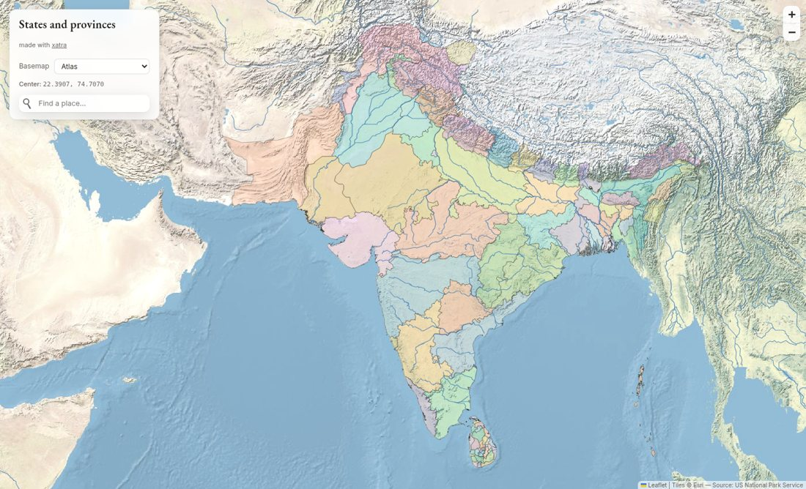
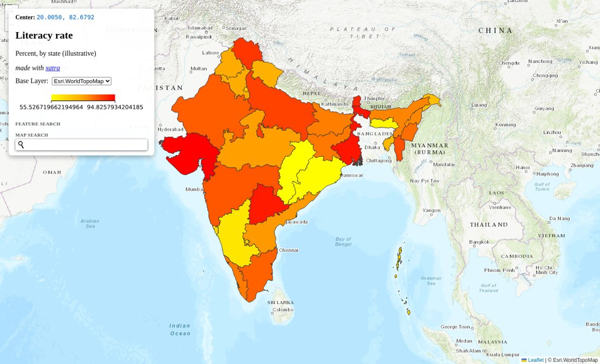
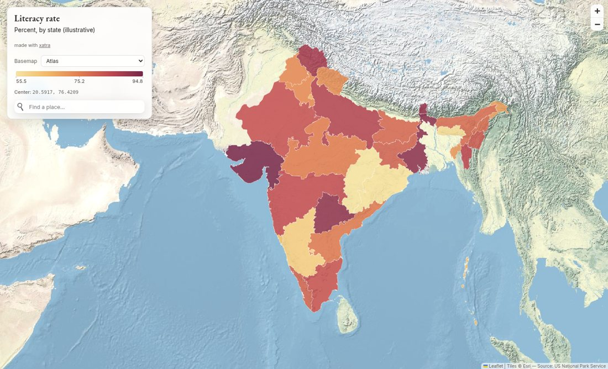

# Default look: before / after

Rendered with no styling options at all (the "before" shots use the old default basemap the GUI shipped with, `Esri.WorldTopoMap`). Regenerate with `uv run python examples/gallery/demo_<name>.py out.html`.

| | Before (2.15) | After (2.16) |
|---|---|---|
| Historical (static) |  |  |
| Historical (time slider) |  |  |
| Administrative |  |  |
| Data (choropleth) |  |  |
